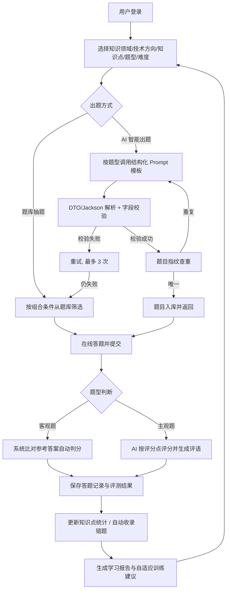
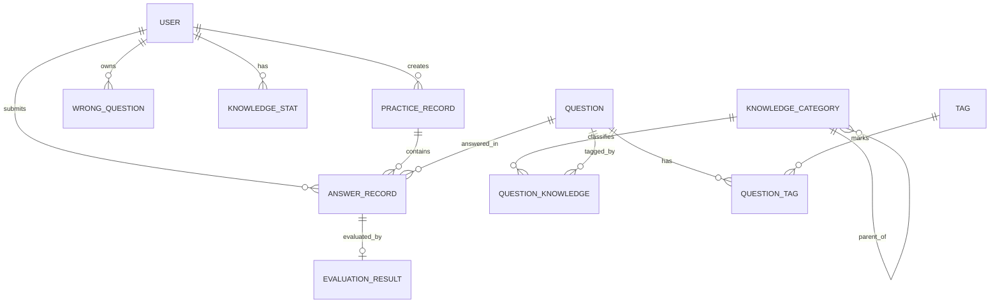

# AI智能面试与学习陪练平台 —— 项目需求文档（Spec）

> 本文档为毕业设计项目需求规格说明书初稿，仅描述需求与设计边界，不包含实现代码。

## 一、项目基本信息

| 项目要素 | 内容 |
| --- | --- |
| 项目名称 | AI智能面试与学习陪练平台 |
| 项目类型 | Web 应用（前后端分离）/ 本科毕业设计 |
| 项目背景 | 程序员及计算机相关岗位求职备考场景下，传统刷题方式缺乏针对性与即时反馈 |
| 项目建设目标 | 构建"选方向—智能出题—在线答题—AI 评测—个性化训练"的学习闭环，为计算机岗位求职者提供智能化、自适应的面试备考与学习陪练服务 |
| 项目适用对象 | 计算机相关专业应届毕业生、程序员求职者、转岗/自学者；平台管理员 |
| 项目预期成果 | 可部署运行的前后端分离系统一套、数据库设计文档、接口文档、测试报告、毕业设计论文 |
| 项目规模评估 | 中型毕业设计规模：9 个功能模块、约 10 张核心数据表、约 30 个 RESTful 接口，单开发者在一个毕设周期内可完成 |
| 技术栈 | 后端：Spring Boot、Spring AI、MyBatis-Plus、JWT；前端：Vue3、Element Plus；数据库：MySQL |

### 设计假设（非用户已确认需求）

1. **设计假设 1（大模型服务）**：假设可接入一个兼容 OpenAI 协议的大模型 API（通过 Spring AI 配置切换），API Key 由部署者自行申请，平台本身不训练模型。
2. **设计假设 2（初始题库）**：假设上线前由管理员人工录入一批种子题目（每个知识领域不少于 30 题），AI 出题作为增量补充而非唯一题源。
3. **设计假设 3（用户规模）**：面向小规模真实使用（班级/社团级别），单实例部署，并发目标为百级，非互联网大规模平台。
4. **设计假设 4（角色设置）**：仅设"普通用户（学员）"与"系统管理员"两类角色，不引入教师、审核员等第三方角色。
5. **设计假设 5（题型范围）**：题型限定为单选题、多选题、判断题、简答题（主观题）四类，不含在线编程判题（OJ）。
6. **设计假设 6（不涉及）**：不涉及真实企业合作、真实用户数据、支付、社交分享等商业功能。

## 二、项目背景与问题分析

### 2.1 现状与痛点

- **刷题缺乏针对性**：传统题库按固定章节组织，用户无法按"知识领域 + 技术方向 + 知识点 + 题型 + 难度"自由组合定位训练内容。
- **题库内容有限且陈旧**：固定题库无法根据用户需求即时生成新题，热门新技术的题目覆盖不足。
- **主观题无反馈**：简答类面试题在普通刷题软件中只能"对答案"，用户无法获知自己答案的得分点命中情况与改进方向。
- **错题复习无体系**：错题分散，缺乏自动收录、按知识点归类和反复重练机制。
- **学习效果不可见**：用户无法量化了解自己在各知识领域的正确率、掌握度与进步趋势，复习计划凭感觉制定。

### 2.2 传统解决方式的不足

纸质资料与普通在线题库以"静态内容 + 人工自觉"为主，不具备动态出题能力、即时评测能力和数据驱动的个性化训练能力。

### 2.3 本项目拟解决的核心问题

1. 用大模型能力解决"题源不足、出题慢"的问题，并解决其带来的输出不稳定与重复生成问题；
2. 用结构化评测解决"主观题无反馈"的问题；
3. 用练习数据的统计分析解决"学习效果不可见、训练无针对性"的问题，形成学习闭环。

### 2.4 应用价值与研究意义

- 应用价值：为计算机岗位求职者提供低成本、可随时使用的 AI 面试陪练工具。
- 毕设意义：覆盖需求分析、多层级数据建模、AI 工程化落地（Prompt 设计/输出校验/降级兜底）、自适应策略设计、权限安全设计、测试与部署等完整软件工程实践。

## 三、用户角色与使用场景

| 用户角色 | 角色说明 | 核心权限 | 主要使用场景 |
| --- | --- | --- | --- |
| 普通用户（学员） | 注册登录的求职者/学生 | 选择知识方向、题库练习、AI 出题、在线答题、查看评测、管理错题、查看个人学习报告 | 日常刷题、面试前定向突击、错题重练、查看薄弱点 |
| 系统管理员 | 平台维护人员 | 用户管理、知识分类管理、题目管理（录入/审核/上下架）、查看系统日志 | 维护知识体系与种子题库、处理异常题目、监控平台运行 |

## 四、业务流程分析

### 4.1 用户注册、登录与身份认证流程

1. 用户提交用户名、邮箱、密码进行注册，系统校验唯一性并对密码加密存储；
2. 用户登录成功后，后端签发 JWT Token；
3. 前端在后续请求头中携带 Token，后端拦截器解析 Token 获取当前用户 ID；
4. 后端所有涉及个人数据的查询均强制绑定该用户 ID，杜绝越权访问；
5. Token 过期或非法时返回统一 401，前端跳转登录页。

### 4.2 核心业务闭环流程

### 4.3 数据提交、处理与反馈流程

- 客观题：提交后立即比对参考答案得出对错，反馈解析；
- 主观题：提交后调用大模型按预设评分点评分，返回得分、逐条评分点命中情况与改进评语；
- 每次答题异步更新用户在各知识点的统计数据，错题自动进入错题本。

### 4.4 异常情况处理流程

- 大模型超时/不可用 → 重试 → 降级为题库抽题，并提示用户；
- AI 返回 JSON 格式错误 → 解析失败重试，记录告警日志；
- AI 生成重复题目 → 指纹冲突时重新生成或回退题库；
- 网络中断/提交失败 → 前端保留已答内容，允许重新提交。

### 4.5 管理员后台运维流程

登录 → 校验管理员角色 → 维护知识分类/题目/用户 → 查看操作与告警日志。

## 五、功能需求

### 模块 1：用户与权限管理模块

| 项目 | 说明 |
| --- | --- |
| 功能目标 | 提供注册、登录、登出、个人信息维护能力，基于 JWT 实现无状态认证 |
| 适用角色 | 普通用户、管理员 |
| 具体功能 | 注册、登录、登出、修改密码、修改个人资料、管理员用户列表/禁用 |
| 输入信息 | 用户名、邮箱、密码（注册/登录）；新资料 |
| 处理逻辑 | 唯一性校验；BCrypt 加密；登录成功签发 JWT；拦截器解析并绑定用户 ID |
| 输出结果 | Token 及用户基本信息；操作成功/失败提示 |
| 异常处理 | 用户名/邮箱已存在、密码错误、Token 过期 |
| 权限要求 | 注册登录公开；其余接口需有效 Token；管理接口需 ADMIN 角色 |
| 验收标准 | 密码不明文存储；无 Token 访问受保护接口返回 401；用户只能读写本人数据 |

### 模块 2：知识体系与题库管理模块

| 项目 | 说明 |
| --- | --- |
| 功能目标 | 建立"知识领域—技术方向—知识点"多层级分类体系，支撑题目的组织与组合筛选 |
| 适用角色 | 普通用户（浏览/筛选）、管理员（维护） |
| 具体功能 | 分类树维护、题目 CRUD（题干/选项/参考答案/评分点/解析/难度/题型）、题目标签、按领域+方向+知识点+题型+难度组合筛选、题目上下架 |
| 输入信息 | 分类节点信息、题目各字段、筛选条件 |
| 处理逻辑 | 分类自关联树形存储；题目与知识点多对多关联；动态条件分页查询 |
| 输出结果 | 分类树、分页题目列表、题目详情 |
| 异常处理 | 删除被题目引用的分类时禁止并提示；题目字段完整性校验 |
| 权限要求 | 浏览筛选需登录；维护操作仅管理员 |
| 验收标准 | 三级分类可正常建立；五种条件可任意组合筛选且结果正确 |

### 模块 3：AI 智能出题模块

| 项目 | 说明 |
| --- | --- |
| 功能目标 | 基于 Spring AI 调用大模型，按用户指定条件生成结构化题目 |
| 适用角色 | 普通用户 |
| 具体功能 | 按题型维护结构化 Prompt 模板；约束模型输出固定 JSON（题干、选项、参考答案、评分点、知识点、解析）；DTO + Jackson 解析；字段校验；失败重试（≤3 次）；题库兜底；题目指纹查重后入库 |
| 输入信息 | 知识领域/方向/知识点、题型、难度、数量 |
| 处理逻辑 | 渲染 Prompt → 调用模型 → 解析 JSON → 校验必填字段与选项合法性 → 计算指纹查重 → 入库 |
| 输出结果 | 生成成功的题目列表（含来源标记 AI） |
| 异常处理 | 模型超时/格式错误重试；重试耗尽后从题库抽取等价条件题目并提示 |
| 权限要求 | 登录用户；按用户做调用频率限制 |
| 验收标准 | 四种题型均可生成格式合法题目；重复题目不会重复入库；模型不可用时系统可降级出题 |

### 模块 4：在线练习与答题模块

| 项目 | 说明 |
| --- | --- |
| 功能目标 | 支持用户创建练习、逐题作答并提交 |
| 适用角色 | 普通用户 |
| 具体功能 | 创建练习（选条件、定题量）、练习记录管理、逐题答题、计时、提交判分、查看逐题解析 |
| 输入信息 | 练习条件；每题作答内容 |
| 处理逻辑 | 生成练习记录 → 组题 → 保存每题答案记录 → 触发评测 |
| 输出结果 | 练习得分、逐题对错、参考答案与解析 |
| 异常处理 | 重复提交幂等处理；练习中途退出保留进度 |
| 权限要求 | 登录用户，练习与答案记录强制绑定当前用户 ID |
| 验收标准 | 完整走通"创建—答题—提交—出分"流程；用户无法查看他人练习记录 |

### 模块 5：AI 评测模块（主观题）

| 项目 | 说明 |
| --- | --- |
| 功能目标 | 对简答类主观题给出分数、评分点命中情况与评语 |
| 适用角色 | 普通用户（系统内部调用） |
| 具体功能 | 将题目、参考答案、评分点、用户答案组装为评测 Prompt；约束返回 JSON（总分、逐点评分、评语）；解析校验后保存评测结果 |
| 输入信息 | 题目 ID、用户答案 |
| 处理逻辑 | 客观题直接比对答案；主观题调用模型评分，分数按评分点加权汇总 |
| 输出结果 | 得分、评分点逐条命中情况、改进评语 |
| 异常处理 | 评测失败标记为"待评测"，允许重试，不阻塞客观题出分 |
| 权限要求 | 仅系统内部调用，结果仅本人可见 |
| 验收标准 | 主观题可返回结构化评分；评测失败有明确状态与重试入口 |

### 模块 6：错题管理与复习模块

| 项目 | 说明 |
| --- | --- |
| 功能目标 | 自动收录错题，支持归类查看与重练 |
| 适用角色 | 普通用户 |
| 具体功能 | 答错自动入错题本、按知识点/题型筛选、查看当时答案与正确解析、移除已掌握错题、基于错题一键发起重练 |
| 输入信息 | 筛选条件、重练请求 |
| 处理逻辑 | 答题判错时写入错题记录；重练全部答对后可手动/自动标记移除 |
| 输出结果 | 错题分页列表、重练练习 |
| 异常处理 | 同一题目重复答错只更新时间与次数，不重复收录 |
| 权限要求 | 登录用户，仅本人错题可见 |
| 验收标准 | 错题自动收录且去重；重练流程可用 |

### 模块 7：学习能力分析与报告模块

| 项目 | 说明 |
| --- | --- |
| 功能目标 | 基于练习历史生成多维学习画像与个性化训练建议 |
| 适用角色 | 普通用户 |
| 具体功能 | 各知识领域正确率、知识点掌握度、薄弱知识点 Top N、近 30 天练习量与正确率趋势图、生成文字版训练建议 |
| 输入信息 | 统计时间范围（默认近 30 天） |
| 处理逻辑 | 聚合答案记录与知识点统计表；掌握度 = 加权正确率（近期权重更高）；按错误率排序输出薄弱点与建议 |
| 输出结果 | 图表数据（前端 ECharts 展示）与文字建议 |
| 异常处理 | 无数据时返回空状态与引导提示 |
| 权限要求 | 登录用户，仅本人报告 |
| 验收标准 | 统计口径与答题记录一致；趋势图与薄弱点展示正确 |

### 模块 8：自适应训练模块

| 项目 | 说明 |
| --- | --- |
| 功能目标 | 根据用户历史表现动态调整后续题目难度与知识方向 |
| 适用角色 | 普通用户（系统内部策略） |
| 具体功能 | 依据"历史正确率 + 连续答对/答错 + 知识点错误率 + 题目难度"的规则策略：连对升难度、连错降难度、优先推送薄弱知识点题目 |
| 输入信息 | 用户 ID、目标知识范围 |
| 处理逻辑 | 读取近期答题窗口（如近 20 题）计算指标 → 按规则表确定下一题难度与知识点 → 从题库/AI 出题获取 |
| 输出结果 | 一组合成后的自适应练习题目 |
| 异常处理 | 历史数据不足（冷启动）时从中等难度开始 |
| 权限要求 | 登录用户 |
| 验收标准 | 连续答对后题目难度提升、连续答错后下降，可在记录中验证策略生效 |

### 模块 9：系统后台管理模块

| 项目 | 说明 |
| --- | --- |
| 功能目标 | 支撑管理员对用户、知识体系、题目与日志的管理 |
| 适用角色 | 管理员 |
| 具体功能 | 用户列表/禁用、分类树维护、题目审核与上下架、AI 出题失败告警日志、操作日志查询 |
| 输入信息 | 各类管理表单与查询条件 |
| 处理逻辑 | 角色校验 → CRUD → 记录操作日志 |
| 输出结果 | 分页列表与操作结果 |
| 异常处理 | 非管理员访问返回 403 |
| 权限要求 | 仅 ADMIN |
| 验收标准 | 管理员功能可用；普通用户无法访问任何管理接口 |

## 六、非功能需求

### 6.1 性能需求

- 常规页面响应 ≤ 2 秒；题库分页查询（万级题目数据）≤ 1 秒；
- AI 出题/评测属长耗时操作，接口超时设为 60 秒并异步化提示，不阻塞其他请求；
- 支持单实例 100 并发用户在线练习无明显劣化；
- 统计报表基于统计表聚合查询，避免全表扫描。

### 6.2 安全需求

- 密码 BCrypt 加密存储；登录接口防暴力破解（失败次数限制）；
- 全站 JWT 认证，接口按角色鉴权；
- 所有个人数据查询在 SQL 层强制绑定当前用户 ID，防越权；
- 参数化持久层（MyBatis-Plus）防 SQL 注入；输入统一校验；前端输出转义防 XSS；
- AI 出题/评测接口按用户限流，防止恶意刷接口产生高额调用费用；
- 大模型 API Key 仅存在于服务端配置，不进入前端与版本库。

### 6.3 可用性需求

- 答题、出分类页面操作路径 ≤ 3 步；所有操作有明确反馈；
- 加载、空数据、网络异常均有对应界面状态；
- AI 生成过程提供进度提示；
- 页面适配主流桌面浏览器与 13 寸以上屏幕（移动端适配列为可选扩展）。

### 6.4 可靠性需求

- AI 链路具备"重试 + 降级 + 状态标记"三重保障，模型不可用不影响题库练习主流程；
- 答题提交幂等，重复请求不产生重复记录；
- 数据库每日备份（部署脚本附带）；关键操作（管理操作、AI 调用失败）留痕可查。

### 6.5 可维护性与扩展性需求

- 前后端分离、后端按模块分包；Prompt 模板外置为可配置资源，新增题型只需新增模板与枚举；
- 知识分类为自关联树，层级可扩展；
- 大模型接入通过 Spring AI 抽象，更换模型供应商仅需改配置；
- 统一返回格式与全局异常处理，日志按模块输出便于排查。

## 七、系统架构设计建议

### 7.1 总体架构（前后端分离三层）

- **前端**：Vue3 + Element Plus + ECharts，负责页面渲染、表单校验、Token 携带；按"登录注册 / 选题练习 / 答题评测 / 错题本 / 学习报告 / 后台管理"划分页面模块。
- **后端**：Spring Boot 单体应用，按模块分包：auth、knowledge、question、practice、evaluation、wrong、stats、admin、ai；JWT 拦截器统一鉴权；MyBatis-Plus 访问 MySQL。
- **AI 层**：Spring AI 接入大模型；独立的 Prompt 模板管理与"调用—解析—校验—重试—降级"管道，与业务模块解耦。
- **数据库**：MySQL 8.x，存储全部业务数据；题目指纹字段建唯一索引。
- **部署**：后端打 Jar 包、前端 Nginx 托管，Docker Compose 编排（MySQL + 后端 + Nginx），单台云主机可运行。

### 7.2 数据流向

用户操作 → 前端 → RESTful API（JWT 校验）→ 业务模块 → MyBatis-Plus → MySQL；AI 类请求经 AI 管道调用外部模型，结果入库后返回。

### 7.3 技术选型理由

| 技术 | 选择理由 |
| --- | --- |
| Spring Boot | 生态成熟、毕设主流、与 Spring AI 无缝集成 |
| Spring AI | 统一大模型调用抽象，便于切换模型与结构化输出 |
| MyBatis-Plus | 减少 CRUD 样板代码，支持条件构造器实现组合筛选 |
| MySQL | 关系型数据契合多表关联统计场景 |
| JWT | 无状态认证，适配前后端分离 |
| Vue3 + Element Plus | 上手快、组件全，适合管理类与学习类界面 |
| ECharts | 学习报告图表展示 |

> 不引入 Redis、消息队列等中间件：项目规模为百级并发单体应用，避免过度设计；如需缓存/异步队列列为后续扩展。

## 八、数据库需求设计

### 8.1 核心数据表

| 数据表/实体 | 主要字段 | 字段含义 | 主键/外键 | 数据关系 |
| --- | --- | --- | --- | --- |
| user 用户表 | id, username, email, password, role, status, create_time | 账号、加密密码、角色(USER/ADMIN)、状态 | PK: id | 1:N 练习记录/答题记录/错题/知识点统计 |
| knowledge_category 知识分类表 | id, parent_id, name, level, sort | 自关联树：领域→方向→知识点 | PK: id, FK: parent_id→id | 自关联；N:M 题目 |
| question 题目表 | id, type, difficulty, stem, options_json, answer, score_points_json, analysis, source, fingerprint, status, create_time | 题型、难度、题干、选项(JSON)、参考答案、评分点(JSON)、解析、来源(MANUAL/AI)、题目指纹、状态 | PK: id；fingerprint 唯一索引 | N:M 知识点/标签；1:N 答题记录 |
| tag 标签表 | id, name | 题目标签 | PK: id | N:M 题目 |
| question_tag 题目-标签关联表 | id, question_id, tag_id | 关联关系 | FK: question_id, tag_id | 关联表 |
| question_knowledge 题目-知识点关联表 | id, question_id, category_id | 关联关系 | FK: question_id, category_id | 关联表 |
| practice_record 练习记录表 | id, user_id, mode, condition_json, total_count, correct_count, score, status, create_time, finish_time | 练习方式(题库/AI/自适应/错题重练)、条件快照、题量、得分、状态 | PK: id, FK: user_id | 1:N 答题记录 |
| answer_record 答题记录表 | id, practice_id, user_id, question_id, user_answer, is_correct, score, create_time | 单次单题作答 | PK: id, FK: practice_id, user_id, question_id | N:1 练习；1:1 评测结果 |
| evaluation_result 评测结果表 | id, answer_id, eval_type, score, point_results_json, comment, status | 评测方式(AUTO/AI)、得分、评分点命中(JSON)、评语、状态 | PK: id, FK: answer_id | 1:1 答题记录 |
| wrong_question 错题表 | id, user_id, question_id, last_answer_id, wrong_count, status, create_time, update_time | 错题归属、错误次数、复习状态 | PK: id, FK: user_id, question_id；唯一约束(user_id, question_id) | N:1 用户/题目 |
| knowledge_stat 知识点统计表 | id, user_id, category_id, total_count, correct_count, mastery, update_time | 用户在某知识点的答题数、正确数、掌握度 | PK: id, FK: user_id, category_id；唯一约束(user_id, category_id) | N:1 用户/知识点 |
| operation_log 操作日志表 | id, user_id, action, detail, create_time | 管理操作与 AI 告警留痕 | PK: id | N:1 用户 |

### 8.2 关系与约束说明

- 分类为自关联树，删除有子节点或被题目引用的节点时禁止删除；
- 题目指纹 fingerprint = 哈希(题干规范化文本 + 知识点集合 + 难度)，建唯一索引，解决 AI 重复生成问题；
- 错题与知识点统计均按 (user_id, 目标) 建唯一约束，由答题事件驱动更新；
- 删除策略：题目、用户均逻辑删除（status 字段），历史答题与评测记录物理保留，保证统计可追溯；
- 选项与评分点以 JSON 字段存储，兼顾不同题型结构差异。

### 8.3 ER 图（简化）

## 九、接口需求

统一约定：RESTful 风格；除认证接口外均需 `Authorization: Bearer <Token>`；统一返回体 `{code, message, data}`；分页参数 `pageNum/pageSize`；错误码区分 400（参数错误）/401（未认证）/403（无权限）/409（冲突）/500。

| 接口名称 | 请求方式 | 接口路径 | 适用角色 | 输入参数 | 返回结果 | 权限要求 |
| --- | --- | --- | --- | --- | --- | --- |
| 用户注册 | POST | /api/auth/register | 公开 | username, email, password | 用户基本信息 | 无 |
| 用户登录 | POST | /api/auth/login | 公开 | username, password | JWT Token + 用户信息 | 无 |
| 个人信息/修改 | GET/PUT | /api/users/profile | 用户 | 资料字段 | 用户信息 | USER |
| 分类树查询 | GET | /api/categories/tree | 用户 | - | 分类树 | USER |
| 分类维护 | POST/PUT/DELETE | /api/admin/categories | 管理员 | 节点信息 | 操作结果 | ADMIN |
| 题目组合筛选 | GET | /api/questions | 用户 | domainId, directionId, pointId, type, difficulty, keyword, 分页 | 分页题目列表 | USER |
| 题目管理 | POST/PUT/DELETE | /api/admin/questions | 管理员 | 题目字段 | 操作结果 | ADMIN |
| AI 出题 | POST | /api/ai/questions/generate | 用户 | categoryId, type, difficulty, count | 生成题目列表 | USER（限流） |
| 创建练习 | POST | /api/practices | 用户 | mode, 筛选条件, count | 练习 ID + 题目列表 | USER |
| 提交答案 | POST | /api/practices/{id}/answers | 用户 | questionId, userAnswer | 判分结果（客观题即时/主观题异步） | USER（本人） |
| 练习详情/结果 | GET | /api/practices/{id} | 用户 | - | 练习与逐题结果 | USER（本人） |
| 错题列表 | GET | /api/wrong-questions | 用户 | 筛选条件、分页 | 分页错题 | USER（本人） |
| 错题移除/重练 | DELETE/POST | /api/wrong-questions/{id}、/api/wrong-questions/repractice | 用户 | 错题 ID / 条件 | 操作结果/新练习 | USER（本人） |
| 学习报告 | GET | /api/stats/report | 用户 | 时间范围 | 正确率/掌握度/趋势/建议 | USER（本人） |
| 自适应练习 | POST | /api/practices/adaptive | 用户 | 知识范围 | 练习 ID + 题目 | USER |
| 用户管理 | GET/PUT | /api/admin/users | 管理员 | 查询条件/状态 | 用户分页/操作结果 | ADMIN |
| 日志查询 | GET | /api/admin/logs | 管理员 | 类型、分页 | 日志分页 | ADMIN |

> 幂等设计：提交答案接口以 (practiceId, questionId) 判重；AI 出题以指纹判重。

## 十、核心技术难点与解决方案

| 难点 | 描述与原因 | 推荐解决方案 | 验证方式 | 局限性 |
| --- | --- | --- | --- | --- |
| 1. 大模型输出格式不稳定 | 模型可能返回非 JSON、缺字段、选项错位 | 结构化 Prompt 明确 JSON Schema + 示例；DTO + Jackson 严格反序列化；字段校验失败自动重试（≤3 次）；最终降级题库抽题 | 构造异常样本测试解析管道；统计生成成功率 | 无法 100% 保证模型输出，需兜底 |
| 2. AI 重复生成题目 | 同条件下模型易产出相似题目 | 题干规范化 + 知识点集合 + 难度计算哈希指纹；数据库唯一索引硬约束；冲突时重新生成或回退题库 | 同条件连续生成验证无重复入库 | 语义级相似题无法完全识别 |
| 3. 自适应训练策略 | 需平衡难度与挑战性，规则不当会过难/过易 | 规则引擎：滑动窗口正确率、连对/连错计数、知识点错误率加权 → 映射难度档位；冷启动默认中等难度 | 模拟连对/连错序列验证难度变化方向 | 规则策略弱于算法模型，列为可扩展点 |
| 4. 多层级分类 + 多条件组合筛选 | 树形结构与 5 维条件组合查询复杂 | 自关联树 + MyBatis-Plus 动态条件构造；题目-知识点关联表；常用筛选字段建索引 | 组合条件查询结果与预期比对；万级数据压测 | 树深度建议控制在 3 层 |
| 5. 主观题评测可信度 | 模型评分可能存在偏差 | 评分点拆解后逐点评分并加权汇总；Prompt 中限定分值区间与输出格式；保留"待评测/重评"状态 | 人工抽样比对 AI 评分与人工评分的一致性 | AI 评分仅供参考，不能等同人工评审 |
| 6. 数据安全与越权 | 练习/错题/报告均为隐私数据 | JWT 拦截器统一解析用户身份；SQL 层强制绑定用户 ID；管理接口角色校验 | 越权测试用例（携带 A 的 Token 访问 B 的资源） | 需配合接口测试持续回归 |

## 十一、系统创新点与专业能力体现

1. **AI 出题稳定性工程方案**：以"结构化 Prompt + DTO/Jackson 解析 + 字段校验 + 有限重试 + 题库兜底"五级管道，解决大模型输出不稳定问题，保证出题功能可用性（可展示：生成成功率统计）。
2. **题目指纹去重机制**：基于题干规范化、知识点集合与难度生成哈希指纹并配合数据库唯一索引，从机制上杜绝 AI 重复题入库。
3. **规则驱动的自适应训练**：基于滑动窗口正确率、连对连错、知识点错误率的难度动态调整策略，实现"千人千面"的练习路径（可展示：连对后难度曲线上升）。
4. **多维学习画像与可视化报告**：领域正确率、知识点掌握度、薄弱点 Top N、30 天趋势四维统计 + ECharts 可视化，将练习数据转化为可执行的训练建议。
5. **精细化数据隔离**：JWT 身份在持久层强制绑定用户 ID，从架构层面防止横向越权，而非依赖前端隐藏。

## 十二、测试需求

测试范围：单元测试（工具类、统计与自适应策略）、接口测试（全部 RESTful 接口）、功能测试、权限测试、异常测试（AI 故障注入）、性能测试（万级题目筛选、百并发练习）、安全测试（越权/注入）、用户体验测试、验收测试。

| 编号 | 测试场景 | 前置条件 | 操作步骤 | 预期结果 |
| --- | --- | --- | --- | --- |
| TC01 | 注册登录 | 无 | 注册新用户并登录 | 返回 Token，密码密文入库 |
| TC02 | 未认证访问 | 未登录 | 直接请求 /api/practices | 返回 401 |
| TC03 | 越权访问 | 用户 A、B 均有练习记录 | A 携带本人 Token 请求 B 的练习详情 | 返回 403/404，不泄露数据 |
| TC04 | 组合筛选 | 题库含多领域题目 | 按领域+知识点+题型+难度筛选 | 结果全部满足条件且分页正确 |
| TC05 | AI 出题正常 | 模型可用 | 请求生成 5 道单选题 | 返回 5 道字段完整、格式合法的题目 |
| TC06 | AI 出题降级 | 模拟模型超时 | 请求 AI 出题 | 重试 3 次后从题库抽题并提示用户 |
| TC07 | AI 题目去重 | 已存在某指纹题目 | 再次生成相同题目 | 冲突处理，不产生重复记录 |
| TC08 | 客观题判分 | 存在练习 | 提交正确/错误答案 | 判分正确，错题自动入错题本 |
| TC09 | 主观题评测 | 存在简答题作答 | 提交答案 | 返回分数、逐点评分与评语；失败时状态为待评测 |
| TC10 | 自适应策略 | 构造连对 5 题记录 | 发起自适应练习 | 后续题目难度上升；连错则下降 |
| TC11 | 学习报告 | 存在 30 天练习数据 | 查看报告 | 正确率/掌握度/趋势与明细数据一致 |
| TC12 | 权限控制 | 普通用户 Token | 请求 /api/admin/users | 返回 403 |

## 十三、项目实施计划

| 阶段 | 主要任务 | 阶段成果 | 风险点 | 验收标准 |
| --- | --- | --- | --- | --- |
| 第 1 阶段：需求调研与资料收集 | 竞品分析、需求细化、确定范围 | 需求文档定稿 | 范围蔓延 | 需求评审通过 |
| 第 2 阶段：系统设计 | 架构设计、模块划分、技术验证（Spring AI 连通性） | 架构设计说明、技术验证 Demo | 大模型 API 不可用 | Demo 可成功调用模型 |
| 第 3 阶段：数据库与接口设计 | 建表 SQL、接口契约 | 数据库脚本、接口文档 | 表结构返工 | 评审通过 |
| 第 4 阶段：核心功能开发 | 认证、分类、题库、练习答题、客观题判分 | 可运行的主流程 | 进度延误 | 题库练习闭环可走通 |
| 第 5 阶段：AI 与智能化功能开发 | AI 出题管道、主观题评测、错题、统计报告、自适应策略 | 全部功能完成 | 模型输出不稳定 | AI 链路成功率达标 |
| 第 6 阶段：系统测试与优化 | 功能/权限/性能/安全测试与修复 | 测试报告 | 缺陷集中爆发 | 测试用例全部通过 |
| 第 7 阶段：部署与答辩准备 | Docker 部署、论文与文档编写 | 可访问的系统 + 论文初稿 | 部署环境问题 | 线上可演示 |

## 十四、项目范围与风险控制

### 14.1 范围界定

- **必须实现**：本文档第五部分模块 1—9 的全部功能；
- **可选扩展**：移动端适配、Redis 缓存、题目收藏、导出 PDF 报告；
- **不纳入本次毕设**：在线编程判题（OJ）、视频面试、支付、社区功能、微服务化。

### 14.2 风险与规避

| 风险 | 影响 | 规避措施 |
| --- | --- | --- |
| 大模型 API 不可用/欠费 | AI 功能失效 | 题库兜底机制保证主流程可用；Key 配置化便于更换供应商 |
| 模型输出不稳定 | 出题失败率高 | 五级管道（Prompt/解析/校验/重试/降级） |
| AI 评测准确性受质疑 | 答辩演示风险 | 评分点结构化拆解 + 准备人工对比演示案例 |
| 进度风险 | 延期 | 核心功能（模块 1—5）优先，智能化功能次之，后台管理最后 |
| 数据风险 | 统计错误 | 统计口径以答题记录为准，统计表可重算重建 |

## 十五、最终验收标准

1. **功能完整性**：模块 1—9 功能全部可用，学习闭环（选方向→出题→答题→评测→报告→自适应）完整走通；
2. **业务流程正确性**：练习、判分、错题收录、统计更新全链路数据一致；
3. **数据准确性**：报告统计结果与答题明细可对账；
4. **权限安全性**：401/403/越权测试用例全部通过，密码密文存储；
5. **系统稳定性**：AI 故障注入下主流程不中断，降级提示正确；
6. **性能表现**：万级题目筛选 ≤ 1 秒，常规页面 ≤ 2 秒；
7. **界面可用性**：主要流程 ≤ 3 步可达，异常/空态有提示；
8. **文档完整性**：需求、数据库、接口、测试文档齐备；
9. **部署可运行性**：Docker Compose 一键启动，新环境可复现演示；
10. **创新点展示效果**：AI 出题管道、指纹去重、自适应难度变化、学习报告可视化均可现场演示验证。

## 十六、总结

本项目面向程序员求职备考场景，以"题库练习 + AI 出题 + AI 评测 + 错题复习 + 学习分析"构成完整学习闭环。技术上以 Spring Boot + Spring AI + MyBatis-Plus + MySQL + Vue3 实现，重点体现 AI 工程化落地能力（结构化 Prompt、解析校验、重试降级、指纹去重）、规则驱动的自适应训练策略、多维学习数据分析与精细化权限安全设计。项目规模适中、难点明确、可演示性强，适合作为本科毕业设计课题；后续可向在线编程判题、协同学习、移动端方向扩展。
