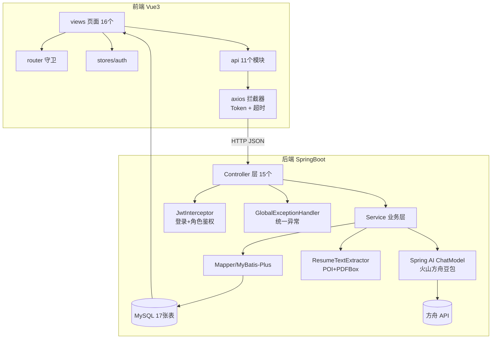
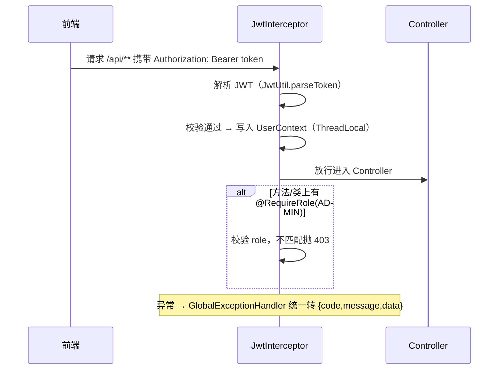
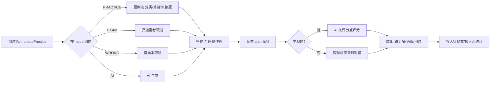
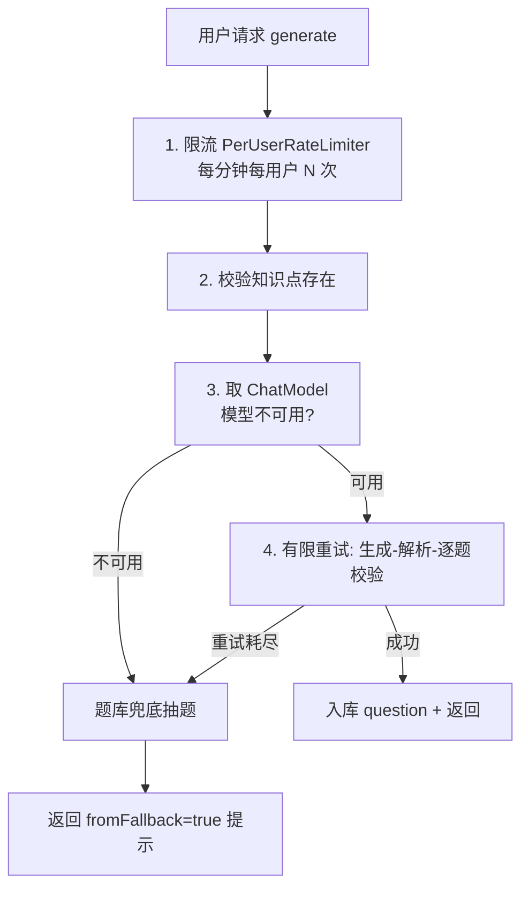
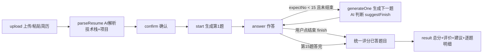

# 项目熟悉手册 —— AI 智能面试与学习陪练平台

> 用途：面试前通读本手册，掌握项目的需求、架构、接口、代码实现与踩坑记录，做到对答如流。
> 适用对象：项目作者本人（Java 全栈求职方向）。

---

## 一、项目一句话介绍

一个面向**计算机专业学生求职备考**的在线学习平台：以**题库练习 + 真题**为基础，叠加 **AI 智能出题** 与 **AI 对话式模拟面试** 两大 AI 能力，通过**错题本、学习报告、后台管理**形成"学-练-测-复盘"闭环。

**三大核心竞争力（面试开场白）**：
1. **AI 智能出题**：基于知识点由大模型生成可入库的高质量题目，模型不可用时自动从题库兜底，不阻塞用户。
2. **AI 对话式模拟面试**：上传简历 → AI 逐题引导式提问 → 答完统一评分，是"真人面试官"而非"试卷生成器"。
3. **完整学习闭环**：专项练习/真题/错题重练/学习报告，按知识点统计掌握度，找薄弱点。

---

## 二、需求分析与最终功能清单

> 说明：原始需求文档（speces 目录）为空，以下需求要点与任务清单依据开发全过程整理，与当前代码实现一一对应。

### 2.1 原始需求（TASK1~TASK6 主线）

| 任务 | 需求内容 | 最终实现 |
|---|---|---|
| TASK1-2 | Spring Boot + Vue3 框架搭建、基础功能 | 全栈工程、JWT 登录注册、统一返回体 |
| TASK3-4 | AI 测评模块 | AI 出题 + AI 面试（对话式）+ 主观题 AI 评分 |
| TASK5-6 | AI 测评完善 | 简历上传解析、动态题数面试、结果报告 |
| 扩展 | 题库/真题/错题/报告/后台管理 | 全部落地 |

### 2.2 最终功能清单（12 个模块）

**面向学习者**：
1. 用户认证：注册 / 登录 / JWT 鉴权 / 角色控制（USER / ADMIN）
2. 题库浏览：按知识点树查看题目（单选/多选/判断/简答）
3. 专项练习：四类卡片（Java/数据库/操作系统/计算机网络 等），按关键词/分类抽题，答题卡 + 计时 + 交卷统计
4. 真题套卷：企业笔试真题（公司 + 年份 + 岗位 + 轮次），点击做题
5. AI 智能出题：选知识点 + 题型 + 难度 + 数量，大模型生成（含限流/重试/题库兜底）
6. AI 对话式面试：上传 Word/PDF 简历 → 解析技术栈/项目 → 对话式逐题面试 → 动态结束 → 统一评分 + 评价建议
7. 主观题 AI 评分：简答题作答后按评分点逐项打分 + 评语（失败降级）
8. 错题本：错题自动收录，支持重练与移除
9. 学习报告：知识点掌握度统计 + 薄弱点 TopN + 学习趋势

**面向管理员**：
10. 后台管理：用户管理（禁用/启用）、题目管理（增删改查/上下架）、操作日志（管理操作留痕）
11. 知识点管理：分类树增删改

**公共**：
12. 落地页 / 帮助与反馈 / 版本信息（无需登录）；信息架构：落地页 + 登录后工作台 + 用户中心 + 设置

### 2.3 开发过程中需求的重要演变（面试可讲"需求迭代"）

| 原始方案 | 问题 | 最终方案 |
|---|---|---|
| AI 面试一次生成 10 题 | 超时（73s+）、无引导 | **对话式逐题出题**，AI 结合回答追问 |
| AI 面试固定 10 题 | 不符合"测评技术栈全面性"目标 | **动态题数**：AI 判断可结束 + 用户随时主动结束 + 兜底 15 题 |
| 面试输入框答题 | 太严谨、体验差 | **聊天式对话界面**（AI 气泡 + 我的气泡） |
| 简历手动粘贴 | 操作性差 | **上传 Word/PDF 自动提取文本**（POI + PDFBox） |
| 本地 Ollama 模型 | 依赖安装、兼容问题多 | **火山方舟豆包模型**（OpenAI 兼容协议接入） |

---

## 三、技术栈总览

| 层 | 技术 | 说明 |
|---|---|---|
| 前端 | Vue 3 + TypeScript + Vite | 组合式 API + `<script setup>` |
| UI | Element Plus + ECharts | 组件库 + 学习报告图表 |
| 状态/路由 | Pinia + Vue Router | 登录态、路由守卫 |
| HTTP | Axios（拦截器统一携带 Token / 超时控制） | |
| 后端 | Spring Boot 4.0.8 + Java 21 | 模块化分包 |
| ORM | MyBatis-Plus 3.5.17 | LambdaQueryWrapper |
| 数据库 | MySQL 8.0（库 `ai_interview_coach`，17 张表） | |
| 鉴权 | JJWT 0.12.6（HandlerInterceptor 拦截器） | 无 Spring Security 全家桶 |
| AI | Spring AI 2.0.1（openai starter）+ 火山方舟豆包模型 | ChatModel / ChatClient |
| 文件解析 | Apache POI 5.3（Word）+ PDFBox 3.0.3 | 简历文本提取 |
| 其他 | Lombok、spring-boot-devtools（热更新） | |

**关键架构决策（面试必问）**：
- **不用完整 Spring Security，自己写 JWT 拦截器**：拦截器 + `@RequireRole` 注解实现登录与角色鉴权，轻量、可控、代码可讲。
- **Spring AI 通过 OpenAI 兼容协议接火山方舟**：模型可热切换（Ollama/方舟/OpenAI 都兼容），`spring.ai.openai.*` 配置驱动。
- **AI 调用全部带"重试 + 降级"管道**：模型不可用/解析失败/评分失败时，用规则兜底，保证功能永不白屏。

---

## 四、系统架构

### 4.1 分层架构



### 4.2 后端模块分包（面试可背目录结构）

```
com.xbmd
├── common        # Result 统一返回 / ResultCode / BusinessException / 全局异常
├── config        # WebConfig(拦截器+跨域) / MybatisPlusConfig / JwtProperties / JacksonConfig
├── security      # JwtInterceptor / RequireRole / UserContext(ThreadLocal)
├── util          # JwtUtil
└── module
    ├── auth        # 注册/登录/个人资料/角色
    ├── question    # 题库 CRUD + 题型枚举 + 内容校验 + 指纹去重
    ├── knowledge   # 知识点树
    ├── practice    # 专项练习/真题：组题-作答-交卷-结算
    ├── ai          # AI 出题：限流-生成-校验-入库-兜底
    ├── interview   # AI 面试：简历解析-对话式出题-评分-总结
    ├── evaluation  # 主观题评分（练习内简答题）
    ├── wrong       # 错题本
    ├── stats       # 学习报告/知识点掌握度
    └── admin       # 后台：用户/题目管理 + 操作日志
```

---

## 五、数据库设计（17 张表）

```mermaid
erDiagram
    USER ||--o{ PRACTICE_RECORD : "发起"
    USER ||--o{ INTERVIEW_SESSION : "发起"
    USER ||--o{ WRONG_QUESTION : "拥有"
    USER ||--o{ ANSWER_RECORD : "作答"
    KNOWLEDGE_CATEGORY ||--o{ QUESTION : "关联"
    QUESTION ||--o{ ANSWER_RECORD : "被答"
    QUESTION ||--o{ WRONG_QUESTION : "错题"
    PRACTICE_RECORD ||--o{ ANSWER_RECORD : "包含"
    ANSWER_RECORD ||--o| EVALUATION_RESULT : "评分"
    INTERVIEW_SESSION ||--o{ INTERVIEW_QUESTION : "包含"
    QUESTION }o--o{ TAG : "question_tag"
    QUESTION }o--o{ KNOWLEDGE_CATEGORY : "question_knowledge"
    EXAM_PAPER ||--o{ EXAM_PAPER_QUESTION : "包含"

    USER { bigint id PK }
    QUESTION { bigint id PK, varchar type, tinyint difficulty, text stem, text options_json, text answer, text analysis, varchar source, varchar fingerprint }
    KNOWLEDGE_CATEGORY { bigint id PK, bigint parent_id, varchar name, tinyint level }
    PRACTICE_RECORD { bigint id PK, varchar mode, text condition_json, int total_count, int correct_count, int score }
    ANSWER_RECORD { bigint id PK, bigint practice_id, text user_answer, tinyint is_correct, int score }
    INTERVIEW_SESSION { bigint id PK, text resume_text, varchar tech_stack, text projects, varchar status, int total_score }
    INTERVIEW_QUESTION { bigint id PK, bigint session_id, int question_no, text question, text user_answer, int ai_score, varchar status }
    EVALUATION_RESULT { bigint id PK, bigint answer_id, int score, text point_results_json, text comment }
    WRONG_QUESTION { bigint id PK, bigint user_id, bigint question_id, int wrong_count }
    EXAM_PAPER { bigint id PK, varchar company, int year, varchar season, varchar round, varchar position, int heat }
    KNOWLEDGE_STAT { bigint id PK, bigint user_id, bigint category_id, int total_count, int correct_count, decimal mastery }
    PRACTICE_CARD { bigint id PK, varchar name, varchar keyword, varchar category_ids_json, varchar related_majors_json }
    OPERATION_LOG { bigint id PK, bigint user_id, varchar action, varchar detail }
```

**核心表速记（面试用）**：

| 表 | 一句话职责 |
|---|---|
| user | 用户，role 区分 USER/ADMIN，BCrypt 加密密码 |
| question | 题库主表，`options_json` 存选项，`score_points_json` 存主观题评分点，`fingerprint` 去重 |
| knowledge_category | 知识点树（如：数据结构→数组/字符串，算法→哈希/递归） |
| practice_record / answer_record | 一次练习 + 逐题作答（mode 区分专项/真题/AI/错题） |
| interview_session / interview_question | 一次 AI 面试 + 逐题（question_no 顺序，status PENDING/SCORED） |
| evaluation_result | 主观题 AI 评分结果（按评分点逐项） |
| wrong_question | 错题本（wrong_count 累计错次） |
| knowledge_stat | 用户×知识点 掌握度（mastery） |
| exam_paper | 企业真题套卷（公司/年份/轮次/岗位） |
| practice_card | 题库卡片配置（Java 卡→关联分类/关键词） |

---

## 六、核心业务流程（按流程理解）

### 6.1 登录鉴权（JWT）



- 登录成功返回 `{token, user}`；前端 axios 请求拦截器自动带 `Bearer token`。
- **白名单**：`/api/auth/register`、`/api/auth/login`（WebConfig 配置 excludePathPatterns）。
- **UserContext 用 ThreadLocal**：请求内取当前用户 ID，请求结束（afterCompletion）清理，防止线程池复用串号。

### 6.2 做题练习（专项/真题/错题/AI 四种模式）



- 选择题提交后**即时**显示对错 + 弹窗解析（错标红、对标绿）；交卷只统计已答数量、正确率、用时。
- 简答题提交触发 **AI 评分**（`AiEvaluationService`），失败降级为按回答长度打分。

### 6.3 AI 智能出题（五级管道）



- 每次生成重试 3 次；校验失败（题干空/选项缺/评分点≠10）会重试。
- 入库走 `QuestionContentValidator`（规范化）+ `QuestionFingerprintUtil`（指纹去重防重复入库）。
- 按题型加载不同 Prompt 模板（`ai/prompts/` 下按题型分文件）。

### 6.4 AI 对话式面试（状态机）



**关键设计（面试必讲）**：
- **对话式**：答完第 N 题，把历史问答 + 简历喂给模型，生成第 N+1 题（可顺着回答追问）。
- **动态题数**：不再固定 10 题。每题生成时 AI 同时输出 `suggestFinish`（是否建议结束）；用户可随时点"结束面试"主动结束；兜底上限 15 题防死循环。
- **评分**：只评已答题目（未答题删除），总分按百分比折算：`sum(每题分) / (已答数 × 10) × 100`，3 线程并发评分，失败降级为按回答长度打分。
- **简历解析**：支持上传 .docx/.doc/.pdf（POI/PDFBox 提取文本）或直接粘贴；AI 解析出 techStack + projects，失败降级为关键词规则扫描。

### 6.5 错题本与学习报告

- 做题判错 → 自动写入 `wrong_question`；错题重练走 mode=WRONG 组题；移除后 status 置为已处理。
- 每次交卷 → `StatsService.updateStats` 更新该用户知识点 `total_count/correct_count/mastery`。
- 学习报告：按知识点掌握度排序取薄弱 Top5、最近练习趋势（ECharts 图表展示）。

### 6.6 后台管理

- 管理员专属（前端路由 meta.admin + 后端 `@RequireRole(ADMIN)` 双保险）。
- 用户管理：查询/禁用启用；题目管理：CRUD + 上下架；操作日志：`AdminOperationInterceptor` 自动记录 `/api/admin/**` 写操作。

---

## 七、API 接口清单（面试可直接背）

> 统一返回：`{code, message, data}`；除登录/注册外全部需 `Authorization: Bearer <token>`。

### 认证与用户
| 方法 | 路径 | 说明 |
|---|---|---|
| POST | /api/auth/register | 注册（BCrypt 加密） |
| POST | /api/auth/login | 登录（返回 token + 用户信息） |
| GET | /api/users/profile | 当前用户资料 |
| GET | /api/admin/profile | 管理员资料 |

### 题库与知识点
| 方法 | 路径 | 说明 |
|---|---|---|
| GET | /api/questions/page | 分页查询题目（题型/难度/分类/关键词过滤） |
| GET | /api/questions/{id} | 题目详情 |
| GET | /api/categories/tree | 知识点树 |
| POST/PUT/DELETE | /api/admin/questions（/api/admin/categories） | 管理端题库/知识点维护 |

### 练习与真题
| 方法 | 路径 | 说明 |
|---|---|---|
| POST | /api/practices | 创建练习（mode+条件组题） |
| POST | /api/practices/{id}/answers | 提交单题答案（幂等，主观题触发 AI 评分） |
| POST | /api/practices/{id}/submit | 交卷批量提交并结算 |
| GET | /api/practices/{id} | 练习详情（含逐题结果） |
| GET | /api/practices/history | 练习历史 |

### AI 能力
| 方法 | 路径 | 说明 |
|---|---|---|
| POST | /api/ai/questions/generate | AI 出题（限流/重试/兜底） |
| POST | /api/interview/resume/extract | 上传 Word/PDF 提取简历文本 |
| POST | /api/interview/sessions | 创建面试会话（AI 解析简历） |
| POST | /api/interview/sessions/{id}/start | 开始面试（生成第 1 题） |
| POST | /api/interview/sessions/{id}/answer | 提交作答，生成下一题 |
| POST | /api/interview/sessions/{id}/finish | 主动结束并统一评分 |
| GET | /api/interview/sessions/{id}/result | 面试结果 |
| POST | /api/evaluations/{answerId}/retry | 重试主观题 AI 评分 |

### 错题/报告/后台
| 方法 | 路径 | 说明 |
|---|---|---|
| GET | /api/wrong-questions | 错题列表 |
| POST | /api/wrong-questions/repractice | 错题重练 |
| DELETE | /api/wrong-questions/{id} | 移除错题 |
| GET | /api/stats/report | 学习报告 |
| GET | /api/admin/users、PUT /{id}/status | 用户管理 |
| GET | /api/admin/logs | 操作日志 |

---

## 八、核心代码实现讲解（面试答"怎么实现的"）

### 8.1 统一返回体与全局异常（common 包）

- `Result<T>`：`{code, message, data}`，`Result.success(data)` / `Result.error(code,msg)`。
- `BusinessException`：携带自定义 code（如 401/403/400/404/500），全局处理器按 code 映射 HTTP 状态码。
- `GlobalExceptionHandler`：`@RestControllerAdvice + @ExceptionHandler` 分类处理——业务异常、`@Valid` 校验失败（MethodArgumentNotValidException/BindException）、JSON 解析失败、类型不匹配、404、兜底异常。
- **面试点**：一个异常一个响应体，前端 axios 拦截器统一解包 code!==200 弹错误，401 清 token 跳登录。

### 8.2 JWT 拦截器与角色鉴权（security 包）

- `JwtInterceptor implements HandlerInterceptor`：preHandle 解析 Bearer token → 校验签名/过期 → 写 `UserContext`（ThreadLocal）→ 查方法级/类级 `@RequireRole` 校验角色。
- `WebConfig` 注册：`/api/**` 全部拦截，仅放行 register/login；另注册 `AdminOperationInterceptor` 记录管理操作日志；同时配全局 CORS。
- **面试点**：为什么不用 Spring Security？——本项目角色只有 USER/ADMIN 两级，拦截器 + 注解足够且代码可读性好；自定义实现能展示对 Spring MVC 拦截链的理解。

### 8.3 Spring AI 接入火山方舟（AI 调用的统一写法）

```java
OpenAiChatOptions.Builder opt = OpenAiChatOptions.builder().maxTokens(maxTokens);
if (StringUtils.hasText(aiModel)) opt.model(aiModel);   // 必须带 model，否则方舟 404
ChatClient client = ChatClient.builder(model).defaultOptions(opt).build();
String content = client.prompt().user(prompt).call().content();
```

- 配置驱动：`spring.ai.openai.base-url/api-key/model/temperature/max-tokens/timeout` 全在 application.yaml。
- **踩坑记录**：方舟必须用**推理接入点 ID**（ep-xxx）作 model，纯模型 ID 全部 404；超时唯一有效键是 `spring.ai.openai.timeout: 300s`（javap 验证过），http-client.* 无效。
- 每类任务有独立 Prompt 模板（ai/prompts/ 目录，classpath 加载）：面试解析/生成/评分/总结、AI 出题按题型。

### 8.4 AI 调用可靠性设计（贯穿全项目的模式）

**五级管道**：`限流 → 校验 → 调用生成 → JSON 解析校验 → 题库/规则兜底`
- 限流：`PerUserRateLimiter` 内存滑动窗口（ConcurrentHashMap<userId, Deque<时间戳>>，每分钟 N 次）。
- 重试：`maxRetries=3`，解析失败/校验失败重试。
- 兜底：出题失败从题库抽题（返回 fromFallback=true 提示用户）；简历解析失败按关键词规则扫描；评分失败按回答长度降级打分；总结失败按分数段模板降级。
- **面试点**：AI 功能的核心是"永远不能让用户等死或白屏"——模型不可用/超时/输出畸形都有保底路径。

### 8.5 对话式面试状态机（interview 模块）

- 表驱动状态：session.status（CREATED/IN_PROGRESS/FINISHED）+ question.status（PENDING/SCORED）。
- 顺序校验：`expectNo = 已答题数 + 1`，答错顺序直接 400 提示"请按顺序作答"。
- 动态结束：生成下一题时模型输出 `suggestFinish`；用户可调 finish 接口主动结束；`MAX_QUESTIONS=15` 兜底。
- 并发评分：`Executors.newFixedThreadPool(min(3, 题数))`，每题一个任务并发调用评分模型，f.get() 汇总。
- 未答题处理：结束评分前删除未答题目，结果明细只展示已答题。
- 面试题生成 Prompt 关键约束：题目必须紧扣简历技术栈、评分点之和 = 10、难度递进、顺回答追问、判断是否建议结束。

### 8.6 简历文件解析（ResumeTextExtractor）

- `.docx`：XWPFDocument 遍历段落 + 表格；`.doc`：HWPFDocument + WordExtractor；`.pdf`：PDFBox Loader.loadPDF + PDFTextStripper。
- 失败/不支持格式/空文本 → 明确中文错误；超 8000 字符截断；multipart 上限 10MB。
- 前端 el-upload 选择文件 → 调 extract 接口 → 提取文本自动填入输入框（可修改）→ 再走 AI 解析。

### 8.7 前端关键实现

- **axios 拦截器**：请求带 Token；响应解包 data、code!==200 弹错、401 清登录态跳转；**全局超时 60s，AI 长接口单独放宽**（简历解析 120s、面试出题/评分 300s、交卷 180s）——这是解决"AI 请求超时"的关键。
- **路由守卫**：meta.public 放行公开页（/ /help /version /login /register）；需登录页未登录跳 /login?redirect；meta.admin 页面非管理员拦回 /home；已登录访问登录/注册回工作台。
- **布局**：MainLayout 统一壳；管理员登录导航"后台管理"排第一高亮，学习功能降级为次要样式（角色可感知）。
- **对话式面试 UI**：消息数组（AI 气泡带"第 N 题"标签 + 用户气泡）+ 底部输入框回车发送 + AI 打字占位 + 自动滚动到底部 + "结束面试"确认弹窗。

---

## 九、项目踩坑与解决记录（面试"遇到过什么问题"直接用）

| # | 问题 | 现象 | 原因 | 解决 |
|---|---|---|---|---|
| 1 | 端口 8080 被占 | 后端起不来 | 之前进程未释放 | netstat 定位 PID → 停掉旧进程重启 |
| 2 | 本地 Ollama 方案失败 | Jackson 相关包报错、出题网络异常 | 本地模型兼容性/环境问题 | 弃用，改接火山方舟 OpenAI 兼容接口 |
| 3 | 方舟 404 Request failed | AI 调用必失败 | 纯模型 ID 不对，需推理接入点 ID | model 用 ep-20260925xxxx（接入点 ID） |
| 4 | AI 请求超时 | 简历解析/出题提示"请求超时" | axios 全局 15s < AI 实际耗时（11-73s） | 全局 60s + 各 AI 接口单独 120~300s |
| 5 | AI 一次出 10 题超时 | 面试 start 卡死 | 单次生成 10 题 73s+ 超限 | 改为对话式逐题生成 |
| 6 | 固定 10 题不合理 | 无法体现"测全面性" | 需求理解偏差 | 动态题数：AI 判断 + 用户主动结束 + 15 题兜底 |
| 7 | 面试答第 N 题报"本轮已结束" | 顺序错乱 | 未按 expectNo 校验 | answer 强制顺序校验 |
| 8 | 浏览器"记忆登录" | 4 小时后不用登录 | localStorage 存 token（24h 有效期） | 属预期行为；登录态持久化方案说明清楚 |
| 9 | 导航不跟随跳转高亮 | 点击导航灰色不变化 | default-active 绑定问题 | 用 route.path 绑定 activeMenu |
| 10 | 简历粘贴不便 | 操作繁琐 | 需求迭代 | 上传 Word/PDF 自动解析（POI/PDFBox） |
| 11 | 管理员导航混乱 | 管理员显示全部学习功能 | 角色设计争议 | 后台管理置顶高亮 + 学习功能降级次要 |
| 12 | 中文文件写入乱码 | Java 源文件被 PowerShell 改写 | 编码 BOM | Python io.open(utf-8, newline='') 写回 |

---

## 十、部署与运行

```bash
# 后端（端口 8080，需 MySQL 8 + Java 21 + 本地 Maven 仓库）
cd backend
mvn spring-boot:run -Dmaven.repo.local=D:\Maven\maven-repository

# 前端（端口 5173，依赖用 pnpm，npm install 必败）
cd frontend
pnpm dev
```

- 数据库：MySQL `ai_interview_coach`，账号 root / 密码 516888（可环境变量覆盖 DB_PASSWORD）。
- 预置账号：admin / admin123（管理员）；可注册普通用户。
- 环境变量/密钥都在 `backend/src/main/resources/application.yaml`（火山方舟 api-key、model 接入点）。
- 前端类型检查：`npx vue-tsc --noEmit`。

---

## 十一、项目亮点总结与可扩展方向

### 亮点（面试结尾升华）
1. **AI 能力产品化**：不炫技，出题/面试/评分都做成"失败不白屏"的可靠管道，体现工程意识。
2. **对话式面试设计**：从"生成试卷"升级为"模拟真人面试官"，引导式追问 + 动态题数 + 统一评分，符合求职测评真实场景。
3. **全链路闭环**：练（专项/真题）→ 测（AI 面试/出题）→ 复盘（错题本/学习报告），数据驱动找薄弱点。
4. **工程细节扎实**：JWT 拦截器自研、限流器、指纹去重、并发评分、超时分级配置、角色感知导航、操作留痕。

### 可扩展方向（面试被问"以后怎么做"）
- 面试评分接入更强模型 / 支持语音问答（ASR）
- 错题本按知识点智能生成"查漏补缺练习"
- 题库数据爬取自动化 + 标签/难度推荐算法
- 限流器升级 Redis 分布式版本，支持多实例部署
- 简历解析升级 OCR，支持扫描件
- 操作日志/学习报告图表更多维度（周趋势、能力雷达图）

---

*文档生成时间：2026-09-26，基于当前代码盘点（接口 15 个 Controller、表 17 张、前端 16 页）。*
